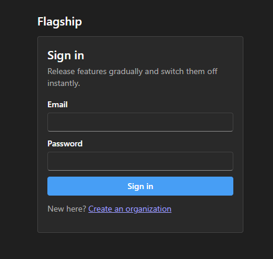
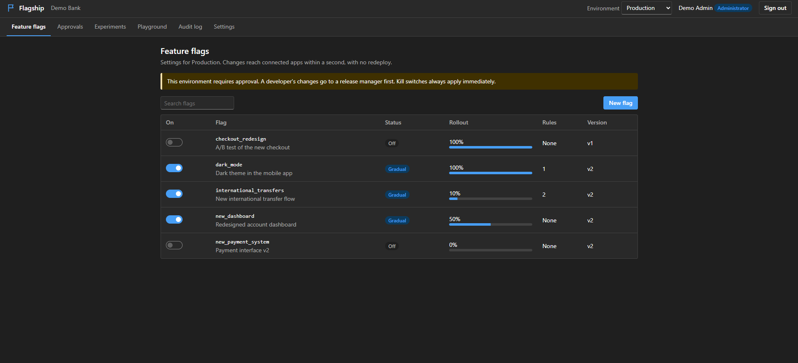
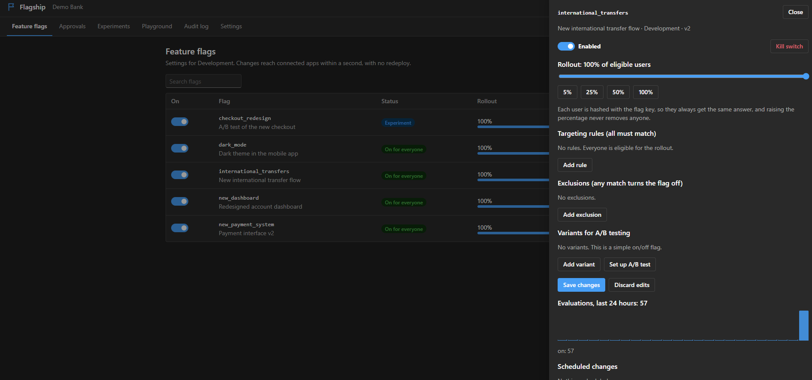
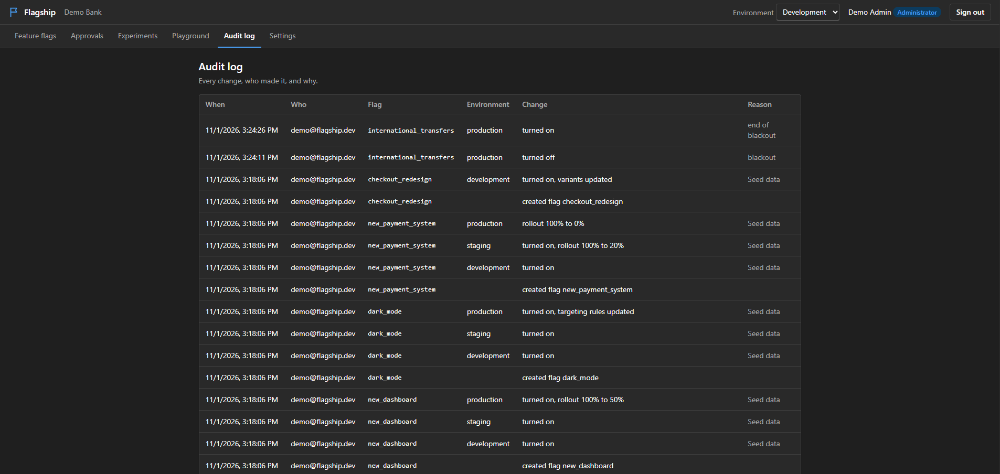
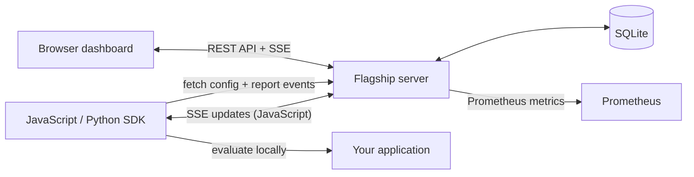

<div align="center">

# Flagship

### Ship features gradually. Learn from real traffic. Roll back instantly.

An open-source feature flag and release management platform with a live dashboard,
local-evaluation SDKs, targeting rules, approval workflows, and experiment analytics.


</div>

## See Flagship

<table>
  <tr>
    <td align="center"><strong>Sign in</strong></td>
    <td align="center"><strong>Feature flags</strong></td>
  </tr>
  <tr>
    <td></td>
    <td></td>
  </tr>
  <tr>
    <td align="center"><strong>Flag configuration</strong></td>
    <td align="center"><strong>Audit log</strong></td>
  </tr>
  <tr>
    <td></td>
    <td></td>
  </tr>
</table>

## What it does

Flagship lets a team control releases independently of application deployments:

- **Gradual rollouts:** enable a flag for a percentage of eligible users. Deterministic bucketing keeps each user's assignment stable, and increasing a rollout does not remove users already included.
- **Targeting and exclusions:** match user attributes with equality, list, text, numeric, date, and existence operators.
- **A/B experiments:** assign weighted variants, record exposures and conversion events, then compare conversion rates and statistical significance.
- **Safe releases:** use separate environments, version history and restore, scheduled changes, and optional developer approval for protected environments.
- **Fast incident response:** a kill switch turns a flag off immediately, including in an environment that normally requires approval.
- **Live operations:** connected apps receive configuration changes over server-sent events (SSE); the JavaScript SDK also polls as a fallback.
- **Team visibility:** role-based access, an organization-scoped audit log, signed change webhooks, and evaluation analytics.

The dashboard also includes an evaluation playground, approval queue, experiment view, and team/environment settings.

## Get started

### Requirements

- Node.js **22.13 or newer** (uses the built-in `node:sqlite` module)
- No top-level npm packages to install

From the project directory, start the server:

```sh
node server/index.js
```

In another terminal, create the demo organization and flags:

```sh
node server/seed.js
```

Open [http://localhost:3000](http://localhost:3000) and sign in with:

| Email | Password |
|---|---|
| `demo@flagship.dev` | `demo1234` |

The seed command prints an SDK key for each environment. You can also create your own organization from the sign-in screen.

Run the test suite with:

```sh
node --test test/*.test.js
```

### Run the example app

The banking example evaluates flags locally, simulates experiment conversions, and keeps watching for changes. Set `SDK_KEY` to the **Development** key printed by the seed command.

PowerShell:

```powershell
$env:SDK_KEY = "fs_development_your_key"
node examples/banking-app.js
```

macOS/Linux:

```sh
SDK_KEY="fs_development_your_key" node examples/banking-app.js
```

Change a flag in the dashboard and watch the example process receive the update. The JavaScript SDK also stores its last configuration in `.flagship-cache.json`, so it can start offline when that cache exists.

## Use an SDK

Both SDKs evaluate flags in-process from cached configuration; flag checks do not make a network request. They share the same deterministic bucketing and evaluation rules.

### JavaScript

```js
const { Flagship } = require('./sdk/js');

(async () => {
  const flags = await new Flagship({
    sdkKey: process.env.SDK_KEY,
    baseUrl: 'http://localhost:3000',
  }).init();

  const user = { id: 'user-42', country: 'Tunisia', plan: 'premium' };

  if (flags.isEnabled('international_transfers', user)) {
    // Show the feature to this user.
  }

  const checkoutVariant = flags.variation('checkout_redesign', user, 'control');
  flags.track(user.id, 'purchase');

  await flags.close();
})().catch(console.error);
```

### Python

The Python SDK has no third-party dependencies. Add `sdk/python` to `PYTHONPATH`, or add that directory to `sys.path` in your application.

```python
from flagship import Flagship

flags = Flagship(
    "fs_development_your_key",
    base_url="http://localhost:3000",
).init()

user = {"id": "user-42", "country": "Tunisia", "plan": "premium"}
enabled = flags.is_enabled("international_transfers", user)
variant = flags.variation("checkout_redesign", user, "control")
flags.track(user["id"], "purchase")
flags.close()
```

The JavaScript SDK refreshes over SSE and polling; the Python SDK refreshes by polling. Both SDKs cache configuration on disk and batch evaluation, experiment exposure, and conversion events back to the server.

## Environments, roles, and releases

Each organization starts with **Development**, **Staging**, and **Production**. Every environment has independent flag configuration and its own SDK key. Production requires approval by default.

| Role | Access |
|---|---|
| **Admin** | Manage flags, team members, environments, webhooks, and releases |
| **Developer** | Create and edit flags; request approval for protected-environment changes |
| **Release manager** | Manage releases and approve or reject developer requests |
| **Viewer** | Read-only access |

For approval-required environments, developer changes remain pending until an admin or release manager approves them. Kill switches intentionally bypass approval so incidents can be handled without delay. Flag changes include version history and can be restored.

## How it fits together



The dashboard is a static, framework-free JavaScript app served by the Node server. The server uses Node's built-in HTTP and SQLite modules; the JavaScript and Python SDKs contain the local evaluation logic.

## API and operations

All `/api/*` management endpoints require a signed-in user token. SDK endpoints authenticate with an environment SDK key in the `x-sdk-key` header.

| Endpoint | Purpose |
|---|---|
| `POST /api/auth/register`, `POST /api/auth/login` | Create an organization or sign in |
| `GET /api/flags`, `POST /api/flags` | List and create flags |
| `PUT /api/flags/:key/environments/:env` | Update a flag configuration |
| `GET .../versions`, `POST .../restore`, `POST .../kill` | Inspect history, restore a version, or activate a kill switch |
| `GET /api/analytics/:flag/:env`, `GET /api/experiments/:flag/:env` | View evaluations and experiment results |
| `GET /sdk/v1/config`, `GET /sdk/v1/stream`, `POST /sdk/v1/events` | SDK configuration, live updates, and batched event reporting |
| `GET /healthz`, `GET /metrics` | Health check and Prometheus metrics |

Configuration is stored in `data/flagship.db` by default. Set these environment variables to customize the server:

| Variable | Default | Description |
|---|---|---|
| `PORT` | `3000` | HTTP port |
| `DATA_DIR` | `./data` | Directory for the SQLite database |
| `FLAGSHIP_SECRET` | Generated on first start | Secret used to sign user session tokens |
| `RATE_LIMIT` | `600` | Per-user requests allowed per minute; SDK keys have a higher limit |
| `CORS_ORIGIN` | Same-origin only for management API | Allowed origin for cross-origin management requests |

For production, set a persistent `DATA_DIR`, provide a strong stable `FLAGSHIP_SECRET`, and serve traffic over HTTPS. Treat the demo account as local-development credentials, not production credentials.

### Docker

```sh
docker compose up --build
```

The app is available at [http://localhost:3000](http://localhost:3000), with its database in the `flagship-data` volume. Set `FLAGSHIP_SECRET` before deploying; the Compose fallback is only a development placeholder.

To also start Prometheus and Grafana:

```sh
docker compose --profile monitoring up --build
```

Prometheus is exposed on port `9090` and Grafana on port `3001`. The Compose file connects Prometheus to Flagship; configure Grafana's Prometheus data source in Grafana to build dashboards.

## Project layout

```text
dashboard/       Browser dashboard (HTML, CSS, JavaScript)
server/          HTTP API, SQLite persistence, seed data, scheduler
sdk/engine.js    Shared JavaScript flag evaluation engine
sdk/js/          JavaScript SDK
sdk/python/      Dependency-free Python SDK
examples/        Example banking application
test/            Engine and API/SDK integration tests
assets/          README and product screenshots
Dockerfile
docker-compose.yml
prometheus.yml
```

## License

Flagship is released under the MIT license.
